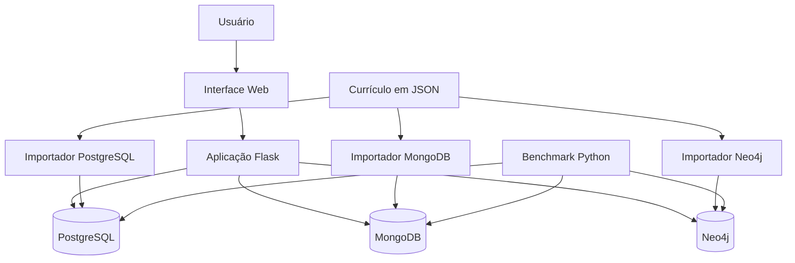

<div align="center">

# 🎓 Consulta à Estrutura Curricular — TADS

**Uma aplicação para consultar disciplinas, créditos e pré-requisitos utilizando três modelos de bancos de dados.**

[](https://www.python.org/)
[](https://flask.palletsprojects.com/)
[](https://www.postgresql.org/)
[](https://www.mongodb.com/)
[](https://neo4j.com/)

</div>

---

## 📌 Sobre o projeto

Este projeto foi desenvolvido para consultar a estrutura curricular do curso de **Tecnologia em Análise e Desenvolvimento de Sistemas (TADS), da Universidade Federal do Rio Grande do Norte (UFRN)**.

A aplicação permite pesquisar disciplinas pelo código ou pelo nome, visualizar créditos e consultar os pré-requisitos obrigatórios e alternativos.

O projeto também implementa e compara três formas de armazenamento de dados:

- **PostgreSQL:** banco de dados relacional.
- **MongoDB:** banco de dados não relacional orientado a documentos.
- **Neo4j:** banco de dados não relacional orientado a grafos.

O objetivo é estudar como diferentes modelos de dados representam a mesma estrutura curricular e comparar o desempenho de consultas equivalentes.

## ✨ Funcionalidades

- 🔎 Pesquisa de disciplinas por código ou nome.
- 📚 Consulta de créditos e pré-requisitos.
- 🔗 Representação de dependências entre disciplinas.
- 🗃️ Armazenamento dos dados em três bancos diferentes.
- 🔄 Importação do currículo a partir de um arquivo JSON.
- 📊 Benchmark para comparar os tempos de consulta.
- 🧩 Modelagem lógica relacional, documental e em grafo.

## 🛠️ Tecnologias utilizadas

| Tecnologia | Utilização |
|---|---|
| Python | Linguagem principal |
| Flask | Aplicação web e API |
| HTML, CSS e JavaScript | Interface do usuário |
| PostgreSQL | Persistência relacional |
| MongoDB | Persistência orientada a documentos |
| Neo4j | Persistência orientada a grafos |
| Docker Compose | Inicialização dos bancos |
| Mermaid e imagens | Documentação e diagramas |

## 🏗️ Arquitetura geral



A interface envia as pesquisas para a aplicação Flask, que consulta os bancos de dados. Os importadores utilizam o arquivo JSON do currículo como fonte dos dados.

## 📂 Estrutura do projeto

```text
Projeto_Consulta_Estrutura_Curricular/
├── app.py
├── docker-compose.yml
├── requirements.txt
├── README.md
│
├── database/
│   ├── curriculo.json
│   ├── banco_relacional.sql
│   ├── importar_postgres.py
│   ├── importar_mongodb.py
│   └── importar_neo4j.py
│
├── benchmarks/
│   ├── benchmark.py
│   └── resultados_benchmark.csv
│
├── docs/
│   ├── modelo_documentos.md
│   ├── banco_relacional/
│   ├── banco_nao_relacional_arquivos/
│   └── banco_nao_relacional_grafo/
│
├── templates/
│   └── index.html
│
└── static/
    ├── css/
    └── js/
```

## 🚀 Como executar o projeto

### 1. Pré-requisitos

Antes de começar, instale:

- [Python](https://www.python.org/downloads/)
- [Docker Desktop](https://www.docker.com/products/docker-desktop/)
- [Git](https://git-scm.com/)

O Docker Desktop deve estar aberto para iniciar os bancos de dados.

### 2. Clonar o repositório

```bash
git clone https://github.com/Marcos-Henrique007/Projeto_Consulta_Estrutura_Curricular.git
cd Projeto_Consulta_Estrutura_Curricular
```

### 3. Criar e ativar o ambiente virtual

No Windows, usando PowerShell:

```powershell
python -m venv .venv
.\.venv\Scripts\Activate.ps1
```

Se o ambiente virtual já estiver ativo, não é necessário ativá-lo novamente.

### 4. Instalar as dependências

```powershell
python -m pip install -r requirements.txt
```

### 5. Inicializar os bancos de dados

Na raiz do projeto, execute:

```powershell
docker compose up -d
```

O Docker Compose inicia os serviços configurados no arquivo `docker-compose.yml`.

| Serviço | Porta local |
|---|---:|
| PostgreSQL | `5432` |
| MongoDB | `27017` |
| Neo4j Browser | `7474` |
| Neo4j Bolt | `7687` |

As credenciais locais de desenvolvimento estão definidas no `docker-compose.yml`. Não utilize essas credenciais de exemplo em ambientes de produção.

Para conferir os serviços:

```powershell
docker compose ps
```

### 6. Importar o currículo para os bancos

Execute os importadores a partir da raiz do projeto:

```powershell
python database/importar_postgres.py
python database/importar_mongodb.py
python database/importar_neo4j.py
```

Os importadores utilizam `database/curriculo.json` como fonte dos dados.

**Atenção:** o importador do MongoDB substitui os documentos da coleção `tads_curricular.cursos`. Utilize-o somente quando essa coleção estiver dedicada aos dados deste projeto.

### 7. Iniciar a aplicação

```powershell
python app.py
```

Abra no navegador o endereço local indicado no terminal. Se a aplicação estiver utilizando a configuração padrão do Flask, normalmente será:

[http://127.0.0.1:5000](http://127.0.0.1:5000)

Para encerrar, pressione `Ctrl + C` no terminal.

## 🧪 Como testar

### Teste manual da interface

1. Inicie os bancos de dados.
2. Importe o currículo para os três bancos.
3. Execute a aplicação Flask.
4. Pesquise uma disciplina pelo código, por exemplo, `TAD0001`.
5. Pesquise pelo nome ou por parte dele, por exemplo, `Fundamentos`.
6. Confira os créditos e os pré-requisitos apresentados.

### Testar a API

Com a aplicação em execução, abra outro terminal e faça uma consulta:

```powershell
$body = @{ busca = "TAD0001" } | ConvertTo-Json

Invoke-RestMethod `
  -Uri "http://127.0.0.1:5000/api/consultar" `
  -Method Post `
  -ContentType "application/json" `
  -Body $body
```

O resultado esperado é uma resposta JSON com as disciplinas encontradas. O formato exato depende da implementação atual da API.

## 🗂️ Modelagem dos dados

O projeto apresenta três modelos lógicos para representar cursos, disciplinas e seus pré-requisitos.

### 1. Modelo relacional — PostgreSQL

O modelo relacional organiza os dados em tabelas e utiliza chaves primárias e estrangeiras para manter os relacionamentos.

**Principais elementos:**
- Cursos.
- Disciplinas.
- Pré-requisitos.
- Pré-requisitos alternativos.

**Diagrama:**


- [Abrir o diagrama relacional em PDF](docs/banco_relacional/modelo_projeto_ciencia_de_dados.pdf)
- [Ver o esquema SQL](database/banco_relacional.sql)

### 2. Modelo documental — MongoDB

O modelo documental utiliza a coleção `cursos`. Cada documento representa um curso e contém uma lista de disciplinas incorporadas, incluindo seus códigos, nomes, créditos e pré-requisitos.

Essa organização permite recuperar as informações do curso e suas disciplinas a partir do mesmo documento.

**Diagrama:**


- [Abrir o diagrama documental em PDF](docs/banco_nao_relacional_arquivos/Diagrama_banco_nao_relacional_documento.pdf)

### 3. Modelo em grafo — Neo4j

O modelo em grafo utiliza nós e relacionamentos direcionados.

- `Curso`: representa o curso.
- `Disciplina`: representa uma disciplina.
- `OFERECE`: relaciona o curso às disciplinas.
- `PRE_REQUISITO_DE`: representa a dependência entre disciplinas.
- `PRE_REQUISITO_ALTERNATIVO_DE`: representa uma relação alternativa de pré-requisito.

Se a disciplina A é pré-requisito da disciplina B, a relação é representada assim:

```text
(Disciplina A)-[:PRE_REQUISITO_DE]->(Disciplina B)
```

**Diagrama:**


- [Abrir o diagrama em grafo em PDF](docs/banco_nao_relacional_grafo/diagrama_grafo.pdf)

### Documento com a descrição dos modelos

O arquivo [`docs/modelo_documentos.md`](docs/modelo_documentos.md) apresenta a descrição dos modelos, seus atributos, relacionamentos e justificativas.

## 📊 Benchmark entre os bancos

O benchmark está implementado em `benchmarks/benchmark.py`.

O teste compara duas consultas:

1. **Busca por código:** `TAD0001`.
2. **Busca por nome:** `Fundamentos`.

### Metodologia

- 3 execuções de aquecimento por consulta.
- 30 repetições medidas por consulta e por banco.
- Conexões estabelecidas antes das medições.
- Registro de média, mediana, mínimo, máximo e quantidade de resultados.
- Exportação dos dados para CSV.

### Resultados de uma execução

Os valores abaixo correspondem à execução registrada durante o desenvolvimento do projeto.

| Consulta | PostgreSQL | MongoDB | Neo4j |
|---|---:|---:|---:|
| Código `TAD0001` | 1,1433 ms | 3,1421 ms | 4,0752 ms |
| Nome `Fundamentos` | 0,7265 ms | 1,2714 ms | 4,4353 ms |

Quantidade de resultados retornados:

| Consulta | PostgreSQL | MongoDB | Neo4j |
|---|---:|---:|---:|
| Código `TAD0001` | 1 | 1 | 1 |
| Nome `Fundamentos` | 2 | 2 | 2 |

### Interpretação

Nessa execução, o PostgreSQL apresentou o menor tempo médio nas duas consultas. O MongoDB ficou em segundo lugar, enquanto o Neo4j apresentou os maiores tempos.

Esses resultados são preliminares e representam somente as consultas, os dados e o ambiente utilizados no teste. Eles não demonstram que um banco será mais rápido em todas as situações.

O tempo medido inclui a execução da consulta e a comunicação com o banco pelo driver Python. Os resultados também podem variar conforme cache, carga do sistema, índices e configuração.

**Importante:** para comparar os bancos de forma justa, é necessário manter dados equivalentes e condições de execução comparáveis.

### Executar novamente o benchmark

Com os três bancos ativos e os dados importados, execute:

```powershell
python benchmarks/benchmark.py
```

O resultado é salvo em:

[`benchmarks/resultados_benchmark.csv`](benchmarks/resultados_benchmark.csv)

O CSV contém os tempos medidos e a quantidade de resultados retornados.

## 📚 Referências e documentos

- [Repositório do projeto](https://github.com/Marcos-Henrique007/Projeto_Consulta_Estrutura_Curricular)
- [Documentação do Flask](https://flask.palletsprojects.com/)
- [Documentação do PostgreSQL](https://www.postgresql.org/docs/)
- [Documentação do MongoDB](https://www.mongodb.com/docs/)
- [Documentação do Neo4j](https://neo4j.com/docs/)
- [Documentação do Docker Compose](https://docs.docker.com/compose/)

A estrutura curricular utilizada como fonte está registrada em `database/curriculo.json`. Para a versão oficial do currículo, consulte também os documentos disponibilizados pela UFRN/SIGAA.

## 👨‍💻 Autores

**Marcos Barbosa, Paolla Oliveira e Kamilly Medino**

Projeto acadêmico desenvolvido no contexto do curso de Tecnologia em Análise e Desenvolvimento de Sistemas (TADS), da UFRN.

---

<div align="center">

**Projeto acadêmico — consulta, modelagem e comparação de bancos de dados.**

</div>
