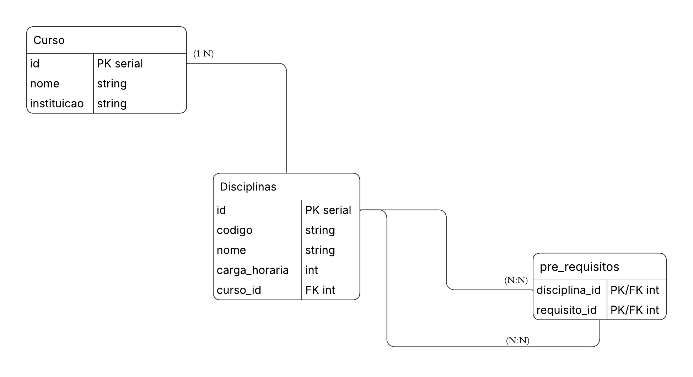
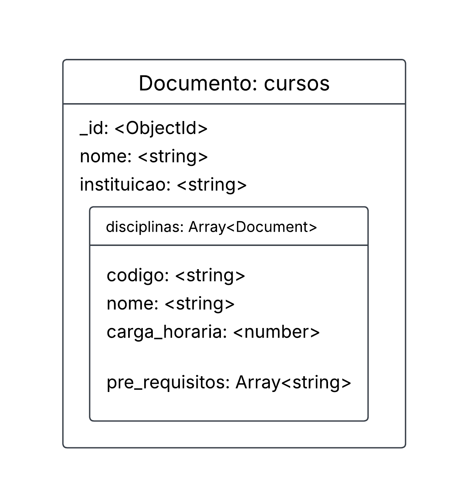
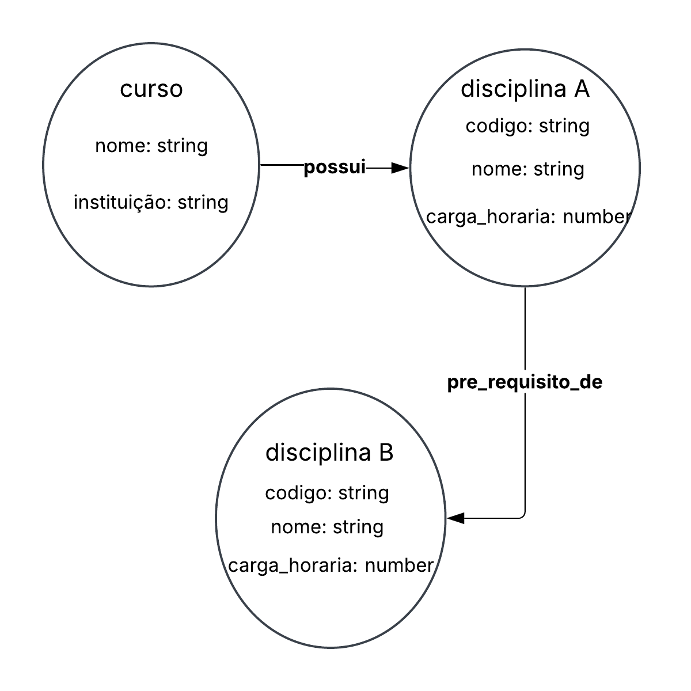

# Modelagem de Dados — Estrutura Curricular

## 1. Introdução

Este documento apresenta três modelos de dados para representar uma estrutura curricular: o modelo relacional, o modelo não relacional orientado a documentos e o modelo não relacional orientado a grafos.

Os três modelos representam cursos, disciplinas e seus pré-requisitos, mas organizam essas informações de maneiras diferentes.

## 2. Modelo Relacional

### 2.1. Entidades e atributos

**Curso**
- `id`: identificador do curso (chave primária).
- `nome`: nome do curso.
- `instituicao`: instituição de ensino responsável.

**Disciplinas**
- `id`: identificador da disciplina (chave primária).
- `codigo`: código da disciplina.
- `nome`: nome da disciplina.
- `carga_horaria`: carga horária da disciplina.
- `curso_id`: identificador do curso ao qual a disciplina pertence (chave estrangeira).

**pre_requisitos**
- `disciplina_id`: identificador da disciplina que possui um pré-requisito.
- `requisito_id`: identificador da disciplina exigida como pré-requisito.

A tabela `pre_requisitos` utiliza uma chave primária composta por `disciplina_id` e `requisito_id`. Os dois campos são chaves estrangeiras que referenciam a tabela `Disciplinas`.

### 2.2. Relacionamentos

- Um curso pode possuir várias disciplinas.
- Cada disciplina pertence a um curso.
- Uma disciplina pode possuir vários pré-requisitos.
- Uma disciplina pode ser pré-requisito de várias outras disciplinas.

### 2.3. Diagrama do modelo relacional



### 2.4. Justificativa

O modelo relacional organiza os dados em tabelas relacionadas por chaves primárias e estrangeiras. Essa estrutura permite manter a integridade dos relacionamentos entre cursos, disciplinas e pré-requisitos, além de facilitar consultas que envolvem diferentes tabelas.

## 3. Modelo Não Relacional Orientado a Documentos

### 3.1. Estrutura dos documentos

Neste modelo, será utilizada uma coleção chamada `cursos` no MongoDB. Cada documento representa um curso e contém seus dados e uma lista de disciplinas incorporadas ao próprio documento.

Os campos principais são:

- `_id`: identificador do documento.
- `nome`: nome do curso.
- `instituicao`: instituição de ensino.
- `disciplinas`: lista de documentos incorporados, contendo:
  - `codigo`: código da disciplina.
  - `nome`: nome da disciplina.
  - `carga_horaria`: carga horária.
  - `pre_requisitos`: lista de códigos das disciplinas exigidas como pré-requisito.

### 3.2. Exemplo de documento

O exemplo abaixo é ilustrativo e não representa dados oficiais de uma matriz curricular.

```json
{
  "nome": "Tecnologia em Análise e Desenvolvimento de Sistemas",
  "instituicao": "UFRN",
  "disciplinas": [
    {
      "codigo": "DISC001",
      "nome": "Introdução à Programação",
      "carga_horaria": 60,
      "pre_requisitos": []
    },
    {
      "codigo": "DISC002",
      "nome": "Programação Avançada",
      "carga_horaria": 60,
      "pre_requisitos": ["DISC001"]
    }
  ]
}
```

### 3.3. Diagrama do modelo documental



### 3.4. Justificativa

O modelo documental permite armazenar as informações do curso e suas disciplinas em um mesmo documento. Isso pode simplificar a recuperação de uma estrutura curricular completa, pois os dados incorporados podem ser consultados juntos.

Os códigos dos pré-requisitos são armazenados em uma lista. Como essa representação não garante, por si só, que cada código corresponda a uma disciplina existente, a aplicação deve validar essas referências.

## 4. Modelo Não Relacional Orientado a Grafos

### 4.1. Nós e propriedades

O modelo em grafo representa os dados por meio de nós e relacionamentos direcionados.

**Nó `Curso`**
- `nome`: nome do curso.
- `instituicao`: instituição de ensino.

**Nó `Disciplina`**
- `codigo`: código da disciplina.
- `nome`: nome da disciplina.
- `carga_horaria`: carga horária.

### 4.2. Relacionamentos

- `(:Curso)-[:POSSUI]->(:Disciplina)`: indica que um curso possui uma disciplina.
- `(:Disciplina)-[:PRE_REQUISITO_DE]->(:Disciplina)`: indica que uma disciplina é pré-requisito de outra.

**Direção do relacionamento:** se a disciplina A é pré-requisito da disciplina B, a ligação será:

`(Disciplina A)-[:PRE_REQUISITO_DE]->(Disciplina B)`

Assim, a seta parte da disciplina exigida e aponta para a disciplina que depende dela.

### 4.3. Diagrama do modelo em grafo



### 4.4. Justificativa

O modelo orientado a grafos representa diretamente as conexões entre cursos e disciplinas, principalmente os relacionamentos de pré-requisito. Essa estrutura facilita percorrer as dependências entre disciplinas e identificar quais matérias precisam ser cursadas antes de outras.

Uma possível implementação desse modelo utiliza o Neo4j, banco de dados orientado a grafos.

## 5. Comparação entre os modelos

| Característica | Relacional | Documental | Grafo |
|---|---|---|---|
| Organização | Tabelas | Documentos e listas incorporadas | Nós e relacionamentos |
| Representação de cursos | Tabela `Curso` | Documentos na coleção `cursos` | Nós `Curso` |
| Representação de disciplinas | Tabela `Disciplinas` | Documentos incorporados | Nós `Disciplina` |
| Pré-requisitos | Tabela associativa | Lista de códigos | Relacionamentos direcionados |
| Principal vantagem | Integridade e consultas relacionais | Recuperação conjunta de dados incorporados | Exploração de conexões e dependências |

## 6. Considerações finais

Os três modelos permitem representar uma estrutura curricular, mas possuem características diferentes. O modelo relacional organiza os dados em tabelas relacionadas; o documental agrupa informações em documentos; e o modelo em grafo destaca as conexões entre disciplinas.

A comparação entre as implementações permitirá avaliar seu comportamento nas consultas utilizadas pela aplicação, considerando o tempo de resposta e as características de cada banco de dados.
